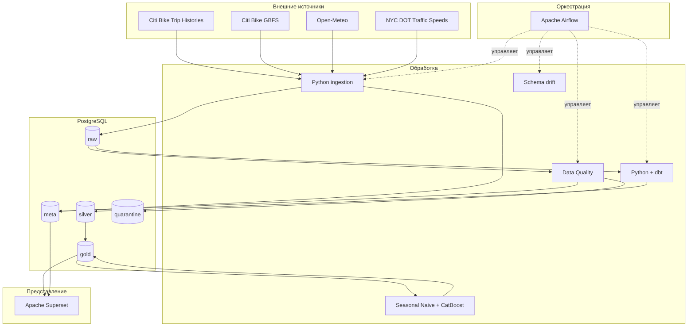

# Архитектура системы

## Общая схема

Система построена как последовательный конвейер обработки данных от внешних источников до прогнозов и BI-панелей.

## Компоненты

### Python ingestion

Загрузчики отвечают за получение внешних данных, повторные запросы, обработку ошибок, дедупликацию и продвижение watermark. Каждый запуск регистрируется в `meta.etl_load_log`.

### PostgreSQL

PostgreSQL используется как единое хранилище бизнес-данных и метаданных проекта. Разделение по схемам позволяет явно отделить исходный слой, очищенные данные, аналитические витрины и служебную информацию.

### Data Quality

DQ выполняется до использования данных в аналитике. Проверки сохраняются в `meta.dq_results`, а некорректные записи дополнительно копируются в `quarantine.rejected_records`.

### dbt

dbt формирует воспроизводимые SQL-преобразования SILVER/GOLD и автоматически проверяет ограничения моделей.

### Apache Airflow

Airflow оркестрирует ежедневный и ежемесячный процессы. Метаданные Airflow хранятся в отдельном PostgreSQL-контейнере и не смешиваются с предметными данными.

### ML

Прогнозный модуль использует временное разделение и сравнивает Seasonal Naive с CatBoost. Результаты сохраняются в `gold.model_metrics` и `gold.forecast_results`.

### Apache Superset

Superset работает с компактными GOLD serving views. Его служебные метаданные также вынесены в отдельный PostgreSQL-контейнер.

## Принципы

- идемпотентность повторных загрузок;
- разделение бизнес-данных и служебных метаданных;
- сохранение исходных RAW-записей;
- воспроизводимые SQL-преобразования;
- временная валидация модели без shuffle;
- автоматизированное журналирование;
- наблюдаемость через Airflow, META-таблицы и Superset;
- контейнеризация инфраструктурных компонентов.
